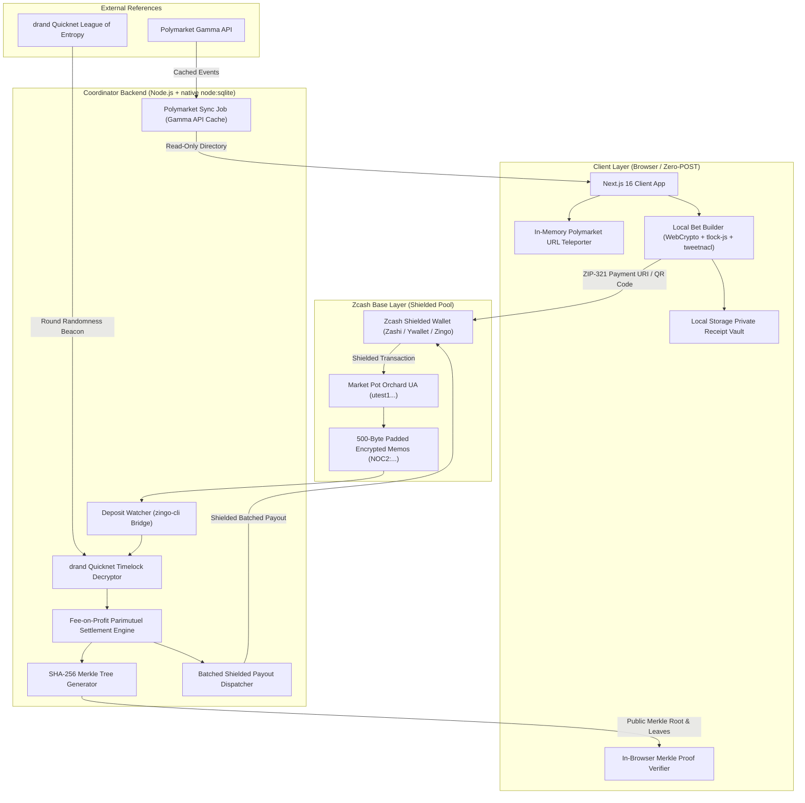
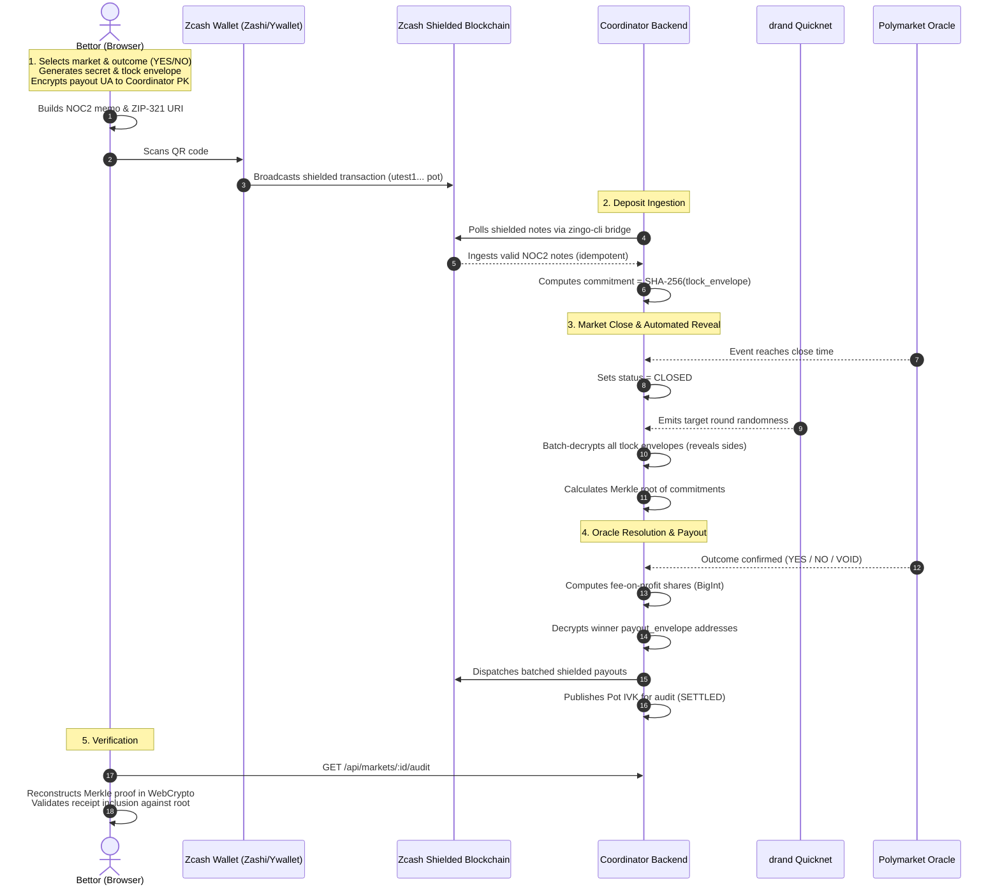
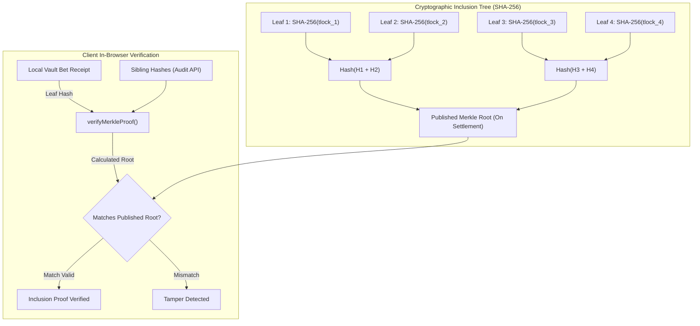

<p align="center">
  
</p>


<h1 align="center">Nocturne Markets</h1>

<p align="center">
  <strong>Public prices. Private people.</strong>
</p>


<p align="center">
  A zero-knowledge, zero-POST prediction market built on Zcash for the ZECATHON Private Markets track. Nocturne Markets mirrors live Polymarket event reference data and resolves outcomes into independent, shielded Zcash parimutuel pools.
</p>

<p align="center">
  <a href="https://youtu.be/MhBTP-hAOfE" target="_blank">
    
  </a>
</p>

<p align="center">
  <a href="https://youtu.be/MhBTP-hAOfE"><strong>Watch the 2-Minute Submission Demo Video</strong></a>
</p>

---

## Submission Labels and Metadata

| Attribute         | Specification                                                  |
| :---------------- | :------------------------------------------------------------- |
| Project Name      | Nocturne Markets                                               |
| Hackathon         | ZECATHON (Hosted by zkSNARKs)                                  |
| Track             | Private Markets                                                |
| Live Website      | https://nocturnemarkets.tech                                   |
| Video Walkthrough | https://youtu.be/MhBTP-hAOfE                                   |
| Target Network    | Zcash Testnet (Shielded Orchard Unified Addresses)             |
| Settlement Model  | Fee-on-Profit Parimutuel Pool (Exact BigInt Zatoshis)          |
| Privacy Core      | Dual-Envelope Memos (drand Quicknet Timelock + TweetNaCl Box)  |
| Client Invariant  | Zero-POST Architecture (Zero HTTP Write Endpoints)             |
| Oracle Source     | Polymarket Gamma API (Read-only reference data and resolution) |
| Verification      | Client-side SHA-256 Merkle Inclusion Proofs + Pot IVK Audit    |

---

## 1. Executive Summary

Prediction markets allow participants to trade financial positions based on real-world beliefs. However, on transparent blockchains (such as Ethereum or Polygon), public wallet addresses expose every trade, portfolio allocation, win, loss, and counterpart relationship. Public ledgers enable third-party profiling, copy-trading, front-running, and the deanonymization of users through linked transactions.

Nocturne Markets brings genuine financial privacy to prediction markets by decoupling public market discovery from participant identity.

Key principles of the system:

1. Public Market Reference: Market questions, categories, and live reference odds are mirrored from Polymarket via read-only APIs.
2. Independent Shielded Pools: Funds do not touch EVM contracts. Bets are placed strictly in shielded Zcash (ZEC).
3. Zero-POST Client: Bettors generate cryptographically sealed bets entirely inside their browser using WebCrypto. The browser never sends HTTP POST requests (no bet preparation, no reveal endpoints), preventing IP profiling and network-level surveillance.
4. Timelock Privacy: Bettor choices (YES or NO) are timelocked to the market close timestamp using drand Quicknet. The coordinator cannot read positions before market close.
5. Confidential Payouts: Winning destination addresses are encrypted to the coordinator settlement key. Public audits can inspect decrypted bet tallies via the Pot Incoming Viewing Key (IVK) without exposing any bettor payout address.

---

## 2. System Architecture

The architecture separates market discovery, cryptographic bet generation, shielded on-chain settlement, and public verifiability into distinct layers.



---

## 3. How Nocturne Leverages Zcash

Zcash is the settlement and privacy bedrock of Nocturne Markets. Rather than attempting to run complex smart contracts on an EVM layer, Nocturne uses Zcash base layer primitives combined with off-chain cryptographic commitments.

### A. Shielded Orchard Unified Addresses (UA)

All market pots use Zcash testnet Unified Addresses (`utest1...`) with receiver priority assigned to Orchard. Both YES and NO bets for a given market are sent to the exact same pot address. An observer inspecting on-chain transactions cannot differentiate between a YES bet and a NO bet by destination address, nor can they observe the transaction amounts.

### B. Standard ZIP-321 Payment Request URIs

The browser creates standard ZIP-321 payment URIs formatted as:
`zcash:utest1...?amount=0.5&memo=NOC2:<base64url>~...`
These URIs are encoded into scannable QR codes and deep-links, making deposits natively compatible with major Zcash wallets including Zashi, Ywallet, and Zingo-cli.

### C. Standardized 500-Byte Encrypted Memo Envelope (NOC2:)

Zcash encrypted transaction memos support up to 512 bytes (per ZIP-302 and ZIP-321). Nocturne packages bets into an exact 500-character wire memo (`NOC2:<base64url>~...`) padded with tilde (`~`) delimiters. Enforcing an identical 500-byte wire length prevents traffic-analysis attacks based on memo size variations.

### D. Dual-Envelope Cryptography

The 500-byte memo carries two distinct cryptographic payloads:

```
+-----------------------------------------------------------------------------------+
| Wire Memo Header: "NOC2:" (5 Bytes)                                               |
+-----------------------------------------------------------------------------------+
| Payload 1: tlock_envelope (217 Bytes Binary)                                      |
| - Target drand Quicknet Round (8 Bytes)                                            |
| - Identity-Based Encryption Ciphertext (128 Bytes)                                |
| - Header MAC (32 Bytes)                                                           |
| - Stream Cipher Body (49 Bytes: AES-GCM Encrypted Side + 16-Byte Bettor Secret)   |
+-----------------------------------------------------------------------------------+
| Payload 2: payout_envelope (110 - 130 Bytes Binary)                               |
| - Compressed Bettor Orchard UA (Bech32m Decoded from 110 Chars to 61 Bytes)       |
| - Ephemeral X25519 Public Key (32 Bytes)                                          |
| - TweetNaCl Box Ciphertext (Encrypted to Coordinator Static Public Key)           |
+-----------------------------------------------------------------------------------+
| Padding: Tilde characters (~) strictly padding string length to 500 Characters     |
+-----------------------------------------------------------------------------------+
```

1. Timelock Envelope (tlock-js):
   The bettor choice (`YES` or `NO`) and a 16-byte random secret are encrypted to a deterministic future drand Quicknet beacon round corresponding to market close. Nobody (including the coordinator) can decrypt the position prior to that round.
2. Payout Envelope (TweetNaCl Box):
   The bettor payout address is compressed and encrypted with a static X25519 key belonging to the coordinator.
3. IVK-Auditing Without Address Leakage:
   After market settlement, the coordinator publishes the Pot Incoming Viewing Key (IVK) for public audit. External verifiers can decrypt incoming transactions to verify that every deposit matched a valid `tlock_envelope`. However, because the bettor return address is sealed inside the `payout_envelope`, public IVK publication never exposes user return addresses.

### E. Fee-on-Profit Parimutuel Settlement

Unlike Automated Market Makers (AMMs) which leak information through continuous micro-price probes, Nocturne uses a parimutuel model calculated in exact BigInt zatoshis (`1 ZEC = 100,000,000 zatoshis`):

$$\text{Gross Payout} = \text{Stake} + \left( \frac{\text{Stake}}{\text{Winning Pot}} \times (\text{Losing Pot} - \text{Protocol Fee}) \right)$$

Key settlement invariants:

- Fee on Profit Only: The protocol fee (200 basis points = 2%) is taken strictly from the losing pot. Winning principal is never taxed.
- Single-Sided and Void Protection: If a market resolves with 0 counterparty volume on one side, or resolves to VOID, all participants receive a 100% refund of their principal minus the standard ZIP-317 network transaction fee.
- Zero Dust Invariant: Total payouts plus protocol fee never exceed the total on-chain pot.

### F. Batched and Delayed Shielded Payouts

Payout transactions are not broadcast immediately upon market close. The coordinator aggregates winners and broadcasts shielded payouts in batched multi-output transactions after random delays, eliminating timing and graph linkage between deposit height and payout height.

---

## 4. Betting and Settlement Flow



---

## 5. Zero-Leak In-Memory Polymarket URL Teleporter

To ensure users never leak their trading intentions or IP address to external servers, Nocturne includes an in-memory URL parser and fuzzy slug matcher (`packages/shared/src/polymarket_url.ts`).

- Zero Network Query Invariant: When a user pastes or enters any Polymarket URL into the search bar, the resolution happens 100% locally in browser memory against pre-cached active market summaries.
- No ad-hoc requests are sent to Polymarket or the coordinator during typing or URL resolution.
- Handles all 9 standard Polymarket URL patterns, including event URLs, explicit sub-market slugs, query parameters, mobile links (`/e/`, `/m/`), condition IDs, and direct address-bar prepends (`nocturnemarkets.tech/https://polymarket.com/...`).

---

## 6. Public Verifiability and Merkle Proofs

Trust in the coordinator is minimized through public client-side auditing:



Every bet commitment is defined as `SHA-256(tlock_envelope)`. At settlement time:

1. The coordinator builds a binary SHA-256 Merkle tree of all valid market commitments and publishes the Merkle root on the audit endpoint (`GET /api/markets/:id/audit`).
2. The user browser fetches the audit payload and verifies the inclusion of their locally stored commitment using native WebCrypto (`app/lib/merkle.ts`).
3. If any commitment was omitted or modified by the coordinator, the mathematical proof fails.

---

## 7. Project Structure

```
nocture-markets/
|-- app/                               # Next.js 16 Web Application (React 19, Tailwind v4)
|   |-- app/
|   |   |-- [...polyUrl]/page.tsx      # Zero-leak address-bar URL teleporter
|   |   |-- market/[id]/page.tsx       # Market detail, price chart, and persistent bet slip
|   |   |-- event/[...slug]/page.tsx   # Polymarket event-level paired multi-outcome view
|   |   |-- blitz/page.tsx             # 5-Minute high-frequency Blitz demo market
|   |   |-- vault/page.tsx             # Dedicated local receipt vault and export/import
|   |   |-- audit/[marketId]/page.tsx  # Fullscreen public Merkle audit and proof inspector
|   |   |-- pitch/page.tsx             # Interactive 60fps presentation deck for demo recording
|   |   +-- layout.tsx & globals.css   # Warm Ember / Obsidian design tokens
|   |-- components/                    # UI Components (MarketCard, MarketBetSlip, MarketGraph)
|   +-- lib/                           # Browser bet builder, WebCrypto Merkle engine, vault storage
|-- coordinator/                       # Fastify Coordinator Backend (Node.js + native node:sqlite)
|   |-- src/
|   |   |-- db/                        # Native SQLite schema, WAL mode, migrations, atomic pots
|   |   |-- jobs/                      # Background workers (polymarketSync, depositWatcher, settlement)
|   |   |-- routes/                    # Read-only REST API (/api/markets, /api/markets/:id/audit)
|   |   +-- index.ts                   # Fastify service bootstrap and graceful worker lifecycle
|-- packages/shared/                   # Shared TypeScript Library
|   |-- src/
|   |   |-- memo.ts                    # NOC2 dual-envelope encoder, decoder, and packaging
|   |   |-- parimutuel.ts              # Fee-on-profit BigInt zatoshis math and refund rules
|   |   |-- polymarket_url.ts          # 9-variant in-memory Polymarket URL parser and slug matcher
|   |   +-- types.ts                   # Shared data structures and interfaces
|-- docs/                              # Engineering logs, specifications, and Zcash references
|   |-- ABOUT.md                       # Product specification and threat model
|   |-- LOGS.md                        # Living context log and architectural decisions
|   |-- PLAN.md                        # Project milestone timeline and data schema
|   +-- references/                    # ZIP-321, ZIP-316, ZIP-317, and testnet infrastructure guides
+-- README.md                          # Repository documentation
```

---

## 8. Honest Threat Model and Trust Analysis

Nocturne Markets does not claim trustless smart-contract execution because the Zcash base layer does not support smart contracts. We plainly document the security boundary, trust assumptions, and mitigations:

| Attack Vector / Leak        | Traditional Approach                           | Nocturne Mitigation                                           | Residual Risk                                                          |
| :-------------------------- | :--------------------------------------------- | :------------------------------------------------------------ | :--------------------------------------------------------------------- |
| Public Chain Surveillance   | Public balances and transactions exposed       | Orchard shielded pools hide sender, receiver, and bet size    | None on base layer.                                                    |
| Operator Front-Running      | Operator reads bet side before market close    | Timelock encryption to drand Quicknet round (`tlock-js`)      | Relies on drand Quicknet beacon integrity.                             |
| Free-Option Withholding     | Bettor must return online post-close to reveal | Automated timelock decryption; bettor never needs to return   | None.                                                                  |
| Bettor IP Address Profiling | Client submits bets over HTTP POST             | Zero-POST architecture: bet sent strictly as an on-chain memo | ISP can see Zcash node broadcast unless using Tor/VPN.                 |
| IVK Audit Address Leak      | Plaintext return address in memo exposed       | Payout address boxed with TweetNaCl to coordinator key        | Only coordinator can read payout destination.                          |
| Memo Size Fingerprinting    | Variable-length memos reveal side/type         | All memos strictly padded to identical 500-byte length        | None.                                                                  |
| Pot Growth Fingerprinting   | Public live pot values reveal bet sizes        | Live pot sizes masked during active betting phase             | None.                                                                  |
| Coordinator Custody Risk    | Coordinator holds pot private keys             | Single-party spending key (Testnet prototype)                 | Coordinator could steal pot (Mitigation: multi-sig / FROST in future). |
| Oracle Dispute Risk         | Multi-sig or AI oracle collusion               | Direct mirroring of Polymarket UMA resolution                 | Upstream Polymarket dispute delays.                                    |

---

## 9. Local Development and Testing

### Prerequisites

- Node.js v20+ or v22+
- pnpm v9+ or v10+

### Installation

```bash
# Clone the repository
git clone https://github.com/Nebulaz7/nocturne-markets.git
cd nocturne-markets

# Install root, coordinator, and app dependencies
pnpm install
```

### Running Automated Test Suites

Nocturne includes comprehensive unit and integration test coverage across the browser Merkle verifier, bet builder, URL parser, SQLite database, and Fastify coordinator settlement engine:

```bash
# Run all unit and integration test suites
pnpm test
```

Individual test targets:

```bash
pnpm test:merkle       # Tests in-browser WebCrypto Merkle engine and tamper rejection
pnpm test:client       # Tests client Zero-POST dual-envelope bet builder roundtrip
pnpm test:url          # Tests 9-variant Polymarket URL parser and in-memory matcher
pnpm test:db           # Tests native node:sqlite schema, atomic updates, and queries
pnpm test:coordinator  # Tests Fastify read-only routes, masked audits, and blitz rounds
pnpm test:api          # Tests client market API hooks and vault verification
```

### Running Locally

```bash
# Terminal 1: Run Coordinator Backend (Port 3000)
pnpm dev:backend

# Terminal 2: Run Next.js Frontend (Port 3001)
pnpm dev:frontend
```

---

## 10. Submission Links

- Video Demo: https://youtu.be/MhBTP-hAOfE
- Live Application: https://nocturnemarkets.tech
- Pitch and Motion Walkthrough: https://nocturnemarkets.tech/pitch
- ZECATHON Submission Track: Private Markets
- Shielded Prize Payout Address: Provided upon official ZECATHON form submission
